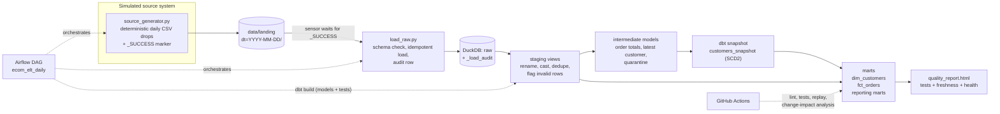

# E-commerce ELT Platform

**Airflow 3 · dbt Core · DuckDB · Python · GitHub Actions**

A local-first e-commerce ELT platform that demonstrates daily batch ingestion, CDC-style incremental transformations, SCD Type 2 customer history, data contracts, layered data-quality tests, and a freshness/quality report. It is designed to run on a laptop using free and open-source tools.

[](https://github.com/Harry160820/ecom-elt-platform/actions/workflows/ci.yml)


## The problem

An online retailer's operational data changes throughout the day: customers move city, prices change, orders move from *placed* to *shipped* to *delivered*, and source systems may resend rows or deliver invalid records. Analysts need trustworthy metrics that reflect what was true at the time of an event—not just the latest state.

This project ingests synthetic source data by batch and builds an analytics warehouse. It is designed to answer questions such as: *What was revenue by city, using the city each customer lived in when the order was placed?*

## What it demonstrates

| Skill | Where to see it |
|---|---|
| Orchestration: sensors, retries, dynamic task mapping and backfills | [`orchastration/dags/ecom_elt_daily.py`](orchastration/dags/ecom_elt_daily.py) |
| Idempotent ingestion, schema checks and audit trail | [`ingestion/load_raw.py`](ingestion/load_raw.py) |
| Incremental model with update handling (high-water mark and delete+insert) | [`dbt_project/models/marts/fct_orders.sql`](dbt_project/models/marts/fct_orders.sql) |
| SCD Type 2 snapshots and as-of joins | [`dbt_project/snapshots/customers_snapshot.yml`](dbt_project/snapshots/customers_snapshot.yml), [`dbt_project/models/marts/dim_customers.sql`](dbt_project/models/marts/dim_customers.sql) |
| Data contracts | [`dbt_project/models/_marts.yml`](dbt_project/models/_marts.yml) |
| Quarantine/dead-letter table and alert threshold | [`dbt_project/models/intermediate/quarantined_order_items.sql`](dbt_project/models/intermediate/quarantined_order_items.sql) |
| Python unit tests, dbt tests and DAG integrity tests | [`tests/`](tests), [`dbt_project/tests/`](dbt_project/tests) |
| CI and change-impact analysis | [`.github/workflows/ci.yml`](.github/workflows/ci.yml) |
| Freshness and quality reporting | [`scripts/build_quality_report.py`](scripts/build_quality_report.py) |

> **Repository path note:** The current directory is named `orchastration` (this spelling is intentional in the commands below because it matches the checked-out project). If you rename it to the conventional `orchestration`, update `AIRFLOW__CORE__DAGS_FOLDER` and the links in this README.

## Architecture



See [`docs/ARCHITECTURE.md`](docs/ARCHITECTURE.md) for lineage, design details and failure-recovery guidance.

## Tools and why they are here

| Tool | Role in this project | Comparable production service/pattern |
|---|---|---|
| **Apache Airflow 3** | Orchestrates daily runs, waits for files, retries and backfills | MWAA, Cloud Composer, Astronomer |
| **dbt Core** | SQL transformations, tests, contracts, snapshots, docs and lineage | dbt with Snowflake, BigQuery, Databricks SQL or Redshift |
| **DuckDB** | Embedded analytical warehouse | Snowflake, BigQuery, Databricks SQL, Redshift |
| **Python** | Source simulator, loader and report generation | Ingestion frameworks and Spark jobs |
| **pytest + Ruff** | Unit tests, linting and formatting | Same tools/patterns |
| **GitHub Actions** | CI for linting, tests and change-impact checks | Jenkins, GitLab CI or other CI systems |
| **Docker Compose** | Optional containerized local deployment | Container orchestration in production |

## Local setup

The local development environment used for this project is a Conda environment named `dbt_project`. The commands below assume that you run them from the repository root in WSL/Linux.

### 1. Activate Conda and install dependencies

```bash
conda activate dbt_project
cd ~/dbt_project

# Install the Airflow version used by this project in the active Conda environment.
pip install "apache-airflow==3.3.2"

# Install the DuckDB Python package used by the ingestion code.
# Keep this version compatible with the dbt-duckdb adapter in your requirements.
pip install "duckdb==2.0.0"
```

Install or refresh the project's development dependencies using the repository's supported setup target, if available:

```bash
make help
```

Check the actual Makefile targets before running `make setup`; the setup target may create a virtual environment rather than use the active Conda environment.

Verify the tools:

```bash
which python
which dbt
which airflow
python --version
dbt --version
airflow version
```

### 2. Run quality checks and dbt

```bash
ruff check
ruff format --check .
pytest -q

dbt build --project-dir dbt_project --profiles-dir dbt_project
```

If you use the shell alias `A` from your local setup, the equivalent dbt command is:

```bash
dbt build $A
```

The project-specific alias is optional; the explicit flags work without it.

### 3. Run the local pipeline

Use the project's documented runner and inspect its options first:

```bash
python scripts/run_pipeline.py --help
```

If the Makefile defines the `run` target, the documented replay command is:

```bash
make run DAYS=7
```

Then open `reports/quality_report.html` in a browser.

## Running the pipeline under Airflow

The DAG file is currently located at:

```text
orchastration/dags/ecom_elt_daily.py
```

The folder spelling matters: configure Airflow to use `orchastration/dags`, not `orchestration/dags`.

### 1. Configure Airflow in the Conda environment

```bash
conda activate dbt_project
cd ~/dbt_project

export AIRFLOW_HOME="$PWD/.airflow"
export AIRFLOW__CORE__LOAD_EXAMPLES=False
export AIRFLOW__CORE__DAGS_FOLDER="$PWD/orchastration/dags"
export PYTHONPATH="$PWD"
export DBT_BIN="$(which dbt)"
```

Initialize or upgrade the Airflow metadata database:

```bash
airflow db migrate
```

### 2. Start the Airflow services and web UI

In the local setup, `airflow standalone` started the scheduler and other services, but its API-server process exited. The working setup used separate processes. Open separate WSL terminals, activate the same Conda environment, move to the repository root, and export the same Airflow variables in each terminal (or put them in a small shell script that you source).

**Terminal 1 — API server (web UI):**

```bash
airflow api-server --port 8081
```

**Terminal 2 — Scheduler:**

```bash
airflow scheduler
```

**Terminal 3 — DAG processor:**

```bash
airflow dag-processor
```

Keep these terminals running. Then open:

**Airflow UI:** [http://localhost:8081](http://localhost:8081)

For the SimpleAuthManager local setup, the username is typically `admin`. Retrieve the generated password from:

```bash
cat "$AIRFLOW_HOME/simple_auth_manager_passwords.json.generated"
```

Do not commit the generated password file or share its contents.

Check that Airflow discovers the DAG:

```bash
airflow dags list
airflow dags list-import-errors
```

The DAG ID should be `ecom_elt_daily`. In the UI, open the DAG's Grid view to inspect task instances, Graph view to inspect dependencies, and task logs to troubleshoot failures. A DAG listed as paused must be unpaused in the UI before normal scheduled/triggered runs.

### 3. Test the DAG from the terminal

`airflow dags test` executes a DAG run for testing; it is useful for local validation and does not behave exactly like a normal scheduler-triggered run.

```bash
airflow dags test ecom_elt_daily 2024-01-01
airflow dags test ecom_elt_daily 2024-01-02
```

The second date is intended to exercise incremental processing and SCD Type 2 change capture. This only demonstrates SCD2 history if the source data for the second logical date actually contains a tracked customer change and the DAG uses the logical date when generating/loading data.

To create normal DAG runs that appear in the Airflow UI, unpause the DAG and trigger runs through the UI or CLI. For example:

```bash
airflow dags trigger ecom_elt_daily --logical-date 2024-01-01
airflow dags trigger ecom_elt_daily --logical-date 2024-01-02
```

The scheduler must be running to process queued runs.

### 4. Optional Docker deployment

The repository also contains Docker-related configuration. Build and run it only after checking the current `Dockerfile`, `docker-compose.yml` and `.env.example`:

```bash
cp .env.example .env
docker compose up --build
```

Stop the stack with:

```bash
docker compose down
```

The Docker image configuration is separate from the host Conda environment: Docker does not reuse the Conda environment installed on your laptop. The current Dockerfile uses a Conda environment inside the image for dbt, while Airflow runs in the image's Airflow Python environment. The Compose deployment should be considered unverified until it has been built and run successfully on your machine.

## Project structure

```text
ecom-elt-platform/
├── ingestion/                 Python source simulator + raw loader
├── dbt_project/               dbt models, snapshots, tests, macros and profile
│   ├── models/staging/         Views: rename, cast, dedupe and validation
│   ├── models/intermediate/    Intermediate transformations and quarantine
│   ├── models/marts/           Dimensions, facts and reporting models
│   ├── snapshots/              SCD Type 2 snapshots
│   ├── macros/                 Schema naming and custom generic tests
│   └── tests/                  Singular business-rule tests
├── orchastration/dags/         Airflow DAG (current directory spelling)
├── scripts/                   Local runner and HTML quality report
├── tests/                     pytest tests, including DAG integrity
├── docs/                       Architecture, data dictionary and guides
├── .github/workflows/          GitHub Actions CI
├── Dockerfile
├── docker-compose.yml
├── Makefile
└── requirements*.txt
```

## Key design decisions

| Decision | Why | Trade-off |
|---|---|---|
| Raw layer is append-oriented with `_batch_date`; each day's load is idempotent | Retries and backfills should not duplicate a batch | Reprocessing a day replaces that day's raw rows |
| Staging centralizes event deduplication and validation | Business rules live in one place | Staging views may scan more raw rows |
| `fct_orders` is incremental on `updated_at` using `delete+insert` on `order_id` | Updates to existing orders can be applied without a full rebuild | Very late rows with old `updated_at` values need a separate lookback strategy |
| Customer history uses dbt snapshots and an as-of join on order time | Revenue can be attributed to the customer's city at order time | Historical joins are more complex than Type 1 dimensions |
| Contracts are enforced on selected marts | Schema drift can fail the build before reaching consumers | Column changes require corresponding YAML updates |
| Invalid order lines are quarantined rather than silently dropped | Bad data remains visible and measurable | An additional table and alert threshold must be maintained |
| dbt runs separately from Airflow's Python dependencies in the container | Reduces dependency conflicts | The image is larger and needs a configured dbt executable path |
| DuckDB is the local warehouse | Free, fast to start and supports analytical SQL | It is an embedded database; concurrent writes need careful coordination |

## Verification status

The following checks have been run in the local Conda environment during development:

- `ruff check` was run and import/lint issues were fixed.
- `pytest -q` completed with **19 passed** and one Airflow provider deprecation warning.
- `airflow dags list` successfully discovered `ecom_elt_daily` from `orchastration/dags/ecom_elt_daily.py`.
- The Airflow API server was made accessible in the browser on port `8081`, with the scheduler and DAG processor started separately.
- The DAG was previously exercised with `airflow dags test`; rerun the Day 1 and Day 2 commands above after any code or configuration changes.

A passing pytest suite and successful DAG discovery do not, by themselves, prove that every end-to-end task, Docker deployment, or GitHub Actions workflow succeeds. Record those as verified only after running them in the target environment.

## Limitations and next steps

- Data is synthetic. Real sources introduce hard deletes, late-arriving rows, schema changes and operational failures not fully represented by the simulator.
- Airflow 3 removed task SLAs. Production alerting should use deadline alerts or an external monitoring system.
- The local project does not require secrets for DuckDB. A cloud warehouse deployment should use a secrets backend or managed identity.
- Natural extensions include a Snowflake or Databricks profile, anomaly detection with Elementary, a late-arriving-data lookback strategy, and a BI dashboard over the marts.

## Learn from it

[`docs/LEARNING_GUIDE.md`](docs/LEARNING_GUIDE.md) walks through the project files, explains the concepts and suggests experiments.